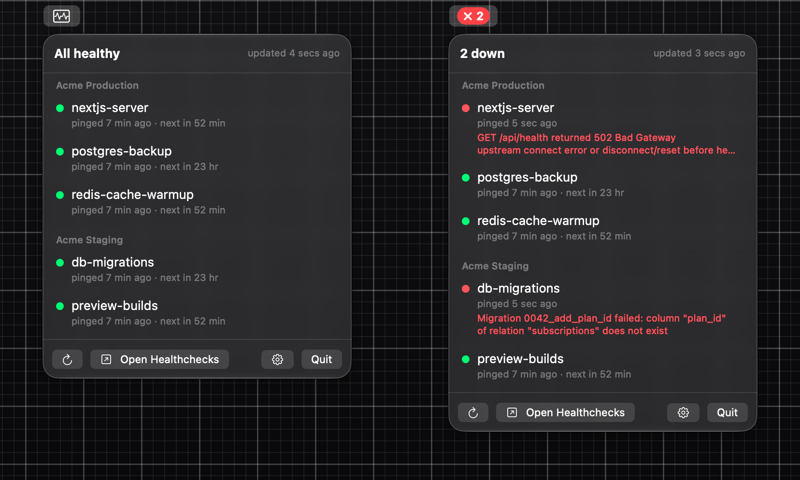

# HealthchecksX

Your [Healthchecks.io](https://healthchecks.io) checks in the macOS menu bar: a red badge with a count when something is down, and a panel with each project's checks and why they failed.



## Install

```sh
brew tap ink-waffle/tap
brew trust --cask ink-waffle/tap/healthchecksx
brew install --cask ink-waffle/tap/healthchecksx
```

Then open the panel, click the gear and add each project with its API key from the project's Settings › API Access on healthchecks.io. Keys are kept in your Keychain. A read-only key works too, but then checks can't be opened or say why they failed.

Needs macOS 14 or later. The app isn't notarized, so the cask clears the quarantine flag and it opens without a Gatekeeper prompt.

## License

[MIT](LICENSE). Not affiliated with Healthchecks.io.
